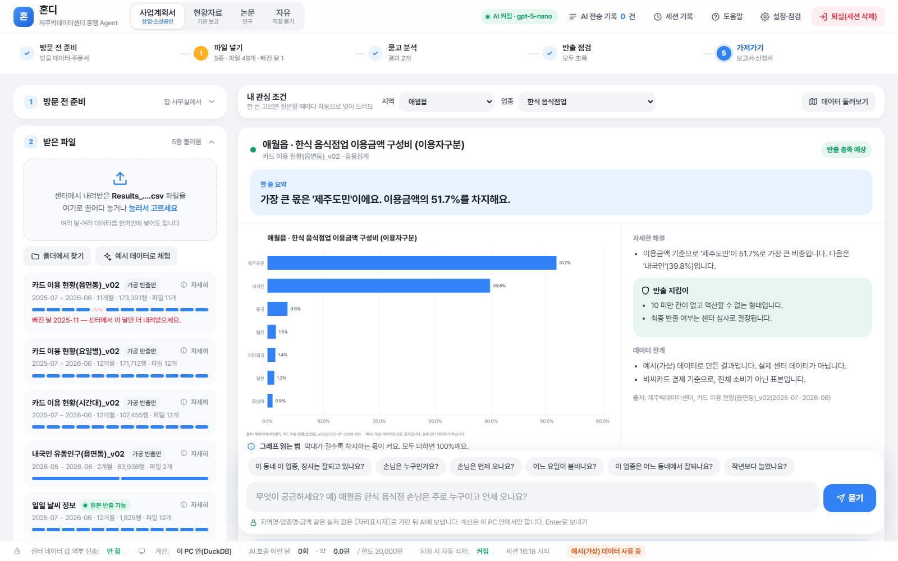

# 혼디 — 제주빅데이터센터 동행 Agent

> **제주 AI·빅데이터 활용 AI Agent 개발 챌린지 · 팀 Kwang 제출본**
>
> | 문서 | 파일 |
> |---|---|
> | 기획서(15쪽) | [제출문서/기획서.pdf](제출문서/기획서.pdf) |
> | 설치·운영 매뉴얼 | [제출문서/설치_운영_매뉴얼.pdf](제출문서/설치_운영_매뉴얼.pdf) · [원문](매뉴얼/설치_운영_매뉴얼.md) |
> | 사용자 매뉴얼 | [제출문서/사용자_매뉴얼.pdf](제출문서/사용자_매뉴얼.pdf) · [원문](매뉴얼/사용자_매뉴얼.md) |
> | 데이터 활용 명세 | [제출문서/데이터_활용_명세.pdf](제출문서/데이터_활용_명세.pdf) · [원문](docs/데이터_활용_명세.md) |
> | 결과 설명자료 | [제출문서/결과_설명자료.pdf](제출문서/결과_설명자료.pdf) · [원문](docs/결과_설명자료.md) · [결과 예시](docs/결과예시) |
>
> 이 저장소에는 API 키가 없습니다. `설치.bat`이 `config.example.ini`로 `config.ini`를 만들며, 키가 없어도 말로 묻기를 뺀 모든 기능이 질문 카드로 동작합니다. 화면·결과 예시는 모두 예시(가상) 데이터입니다.

> "혼디"는 제주어로 '함께'. 센터 분석실 PC에서 비개발자 이용자와 함께 **방문 준비 → 파일 불러오기 → 묻고 분석 → 반출 기준 점검·고치기 → 보고서·반출 신청서**까지 한 화면에서 끝내는 로컬 AI Agent입니다.



## 3분 시작

1. 저장소를 내려받아(Code → Download ZIP) 풀고 **`설치.bat`** 을 두 번 클릭합니다(처음 1회. 파이썬이 없으면 자동 설치를 시도합니다. 개발 PC 리허설 25초, 패키지를 처음 내려받는 PC는 몇 분 걸릴 수 있음).
2. **`실행.bat`** 을 두 번 클릭하면 브라우저에 혼디가 열립니다(`http://127.0.0.1:8765`).
3. 첫 화면의 **예시 데이터로 체험** → 데이터 둘러보기에서 **내 관심 조건**(지역·업종) 고르기 → 질문 카드 누르기(바로 계산) → 결과 맨 위 **한 줄 요약**과 신호등 확인 → 보고서·신청서 만들기.

센터 PC에서는 센터 조회 화면에서 내려받은 `Results_YYYYMMDD_HHMMSS.csv` 파일을 ②에 끌어다 놓으면 데이터 종류·기간을 자동 인식합니다.

## 무엇이 다른가

| 문제(센터 이용자가 실제로 막히는 곳) | 혼디 |
|---|---|
| 한 번에 1개월씩만 조회·다운로드 → 12개월이면 12번 | 방문 전 **다운로드 주문서**와 **운영자 요청문**, 파일 자동 인식·병합, **빠진 달 표시** |
| 비개발자가 SQL·Python을 못 씀 | 질문 카드 + 자연어 질문 → **AI가 분석 계획(JSON)만** 세우고, 계산은 PC 안 DuckDB가 수행 |
| 센터 데이터를 외부 AI에 보내면 안 됨 | **값 방화벽**: 질문 속 지역명·업종명·숫자를 〔자리표시자〕로 바꿔 전송, 보낸 글 전부를 화면·기록에 공개 |
| 반출 심사에서 반려(10 미만, 역산 가능) | **반출 지킴이**: 2026.09.01 반출 정책 기준 신호등 + 한 번에 고치기(범주처리·비율·삭제처리·수치 빼기) |
| 반출 신청서 작성이 어려움 | 센터 신청 화면 칸 그대로 **신청서 초안** + 점검 메모 + 출처 표기된 보고서 PDF |
| 퇴실 시 자료 삭제 | **퇴실 버튼** 한 번으로 세션 파일·결과·AI 기록 삭제 |

## 구성

| 경로 | 내용 |
|---|---|
| `app/` | 서버(`server.py`), 파일 인식(`ingest.py`), 분석 도구 8종(`tools.py`), 반출 지킴이(`guard.py`), 값 방화벽(`firewall.py`), 계획 수립(`planner.py`), 해설·그림·보고서·신청서 |
| `app/data/catalog.json` | 센터 데이터 명세서(v13) 71종을 기계가 읽는 형태로 변환한 것 |
| `web/` | 화면(HTML·CSS·JS, 외부 라이브러리 없음) |
| `demo/` | 체험용 **예시(가상) 데이터**. 실제 센터 데이터가 아님 |
| `매뉴얼/` | 사용자 매뉴얼, 설치·운영 매뉴얼 |
| `docs/` | 데이터 활용 명세, 결과 설명자료, 설계 문서, 화면 캡처 |
| `tests/` | 자동 테스트 178개(`pytest -q`) |
| `tools/` | 명세서 → 카탈로그 변환, 화면 캡처, 제출 ZIP 생성 |

## 환경

- Windows 10/11, Python 3.11~3.13(권장 3.12), 메모리 8GB 이상 권장. GPU 불필요(센터 PC 사양 i7-8700·32GB에 맞춰 설계, 개발 PC에서 검증).
- 패키지: `duckdb==2.0.0`, `matplotlib==3.11.2`(+ numpy, pillow, contourpy, cycler, fonttools, kiwisolver, packaging, pyparsing, python-dateutil). 화면·서버는 파이썬 표준 라이브러리.
- PDF 변환: Windows 기본 Microsoft Edge(헤드리스 인쇄). 없으면 HTML 보고서로 대신합니다.
- AI: OpenAI `gpt-5-nano`(입력 100만 토큰당 0.05달러). 키가 없어도 말로 묻기를 뺀 모든 기능(질문 카드 분석·반출 점검·보고서)이 동작합니다.

## 외부로 나가는 통신(전부)

| 주소 | 언제 | 무엇을 |
|---|---|---|
| `https://api.openai.com/v1/chat/completions` | 말로 묻기(계획 수립) | 가려진 질문 + 공개 명세(컬럼명·업종 코드). **센터 데이터 값 없음** |
| `https://open.jejudatahub.net/api/proxy/...` | 방문 전 미리보기(선택) | 공개 데이터 조회 조건. 키가 없으면 호출하지 않음 |
| `https://www.jejudatahub.net/data/view/data/...` | 미리보기의 '원문' 링크를 누를 때 | 브라우저로 공개 데이터 소개 페이지 열기 |
| `pypi.org`, `files.pythonhosted.org`, `winget`/`python.org` | 설치 시 1회 | 패키지·파이썬 내려받기 |

모든 주소는 행안부 불법광고 차단 키워드 목록과 대조해 **설정·점검** 화면에서 확인할 수 있습니다.

## 테스트

```
.venv\Scripts\python -m pip install -r requirements-dev.txt
.venv\Scripts\python -m pytest -q
```
