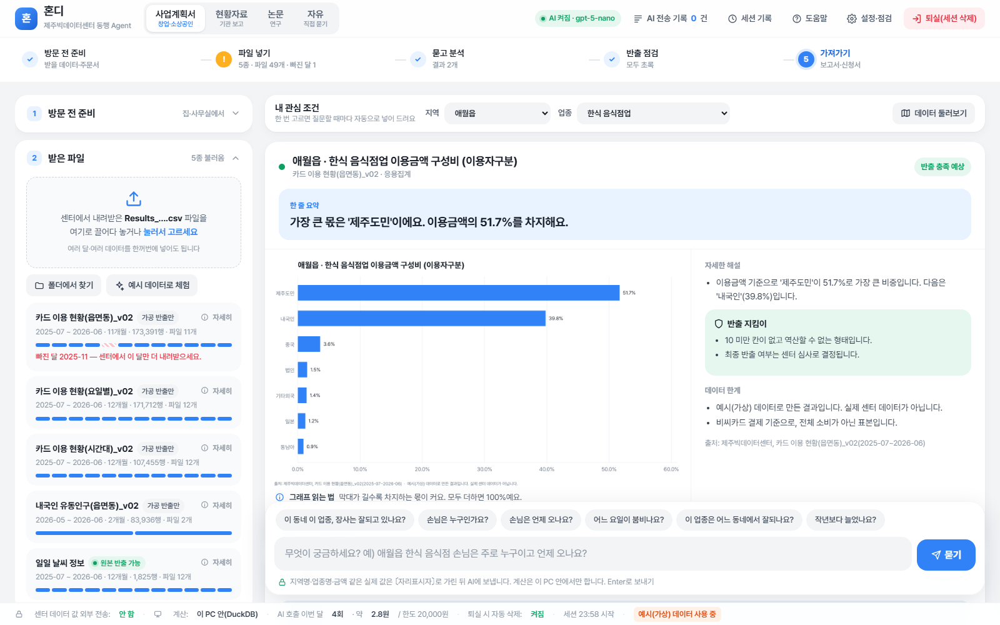

# 혼디 결과 설명자료

팀 Kwang · 제주 AI·빅데이터 활용 AI Agent 개발 챌린지

대회 안내의 결과 설명자료 항목(문제 정의 · Agent 구조 · 주요 기능 · 실행 결과 · 검증 방법·한계 · 센터 활용 방안) 순서로 정리했습니다. 화면과 결과 예시는 모두 **예시(가상) 데이터**로 만든 것이며 실제 센터 데이터가 아닙니다.

## 1. 문제 정의

대회 주제: "IT 비전문가인 도민도 제주빅데이터센터에서 직접 실행하고 활용할 수 있도록, 데이터 탐색부터 분석 결과 제공까지 수행하는 서비스".

센터 이용 규칙 가운데 비전문가가 직접 하기 어려운 부분을 대회 게시판 답변·공지·센터 이용방법·반출 기준에서 확인했습니다.

| 확인된 사실(출처) | 혼디가 하는 일 |
|---|---|
| 데이터는 한 번에 1개월씩 조회·다운로드(게시판 답변) | 여러 달 파일을 한꺼번에 받아 데이터별로 합치고 빠진 달 표시 |
| 파일 이름이 Results_날짜_시간.csv라 종류를 알 수 없음(게시판 답변) | 컬럼 구성을 명세서 71종과 대조해 종류, 기준년월 값으로 달 판별 |
| 방문 목적은 주로 사업계획서·현황자료·논문(센터 답변) | 목적별 질문 카드와 보고서 목차 |
| 10 미만 비공개·역산 불가·원본 발췌 금지(반출 기준 2026.09.01), 조건과 활용계획의 관련성도 심사(게시판 답변 11/15) | 결과마다 반출 신호등·이유·고치기 버튼, 점검 메모 |
| 신청서 설명 칸은 "(분석 방법)으로 분석 후 (가공처리)로 가공하여 … 활용" 형식(이용방법) | 실제 분석·가공처리로 채운 신청서 초안 |
| 센터 원본·조회 결과는 외부 AI로 보낼 수 없음(대회 규정) | 질문 속 값을 〔자리표시자〕로 가려 전송, 보낸 글 전부 공개 |
| 퇴실 시 승인 자료 외 삭제, 담당자가 매뉴얼대로 설치(공지) | 퇴실 버튼 한 번으로 삭제, 배치 파일 두 개로 설치·실행 |

## 2. Agent 구조



| 층 | 구성(코드) | 하는 일 |
|---|---|---|
| 화면 | `web/` | 데이터 둘러보기, 내 관심 조건, 질문 카드·말로 묻기, 결과 카드, 보고서·신청서, 퇴실 |
| 로컬 서버 | `app/server.py` | 127.0.0.1 전용 JSON API, 다른 사이트 요청 차단(Host·Origin 검사), 세션별 폴더 |
| 값 방화벽 | `app/firewall.py` | 질문 속 범주 값·3자리 이상 숫자를 〔자리표시자〕로, 전송 기록·월 한도 |
| 계획·검증 | `app/planner.py`, `app/llm.py` | AI(gpt-5-nano)가 도구·데이터·조건을 고른 계획(JSON) → 검증 → 실패 시 1회 재요청 → 질문 카드로 대체 |
| 도구 8종 | `app/tools.py` | 추이·전년 대비·구성비·순위·비교·증감 기여·지역 현황·기술통계를 DuckDB SQL(바인딩)로 계산 |
| 반출 지킴이 | `app/guard.py` | 10 미만·역산·한 행·응용집계 분모 점검, 신호등, 고치기 4종 |
| 쉬운 결과 | `app/narrate.py`, `app/charts.py` | 해요체 한 줄 요약, 그래프 읽는 법, 해설, 데이터 한계, 출처가 인쇄된 그림 |
| 문서 | `app/report.py`, `app/export_form.py` | 목적별 보고서(HTML·PDF), 반출 신청서 초안, 점검 메모, 묶음 ZIP |
| 데이터 | `app/ingest.py`, `app/catalog.py` | CSV 인식·병합·중복 제거·빠진 달, 명세서 71종 카탈로그 |
| 운영 | `app/session.py`, `app/selfcheck.py` | 설정, 퇴실·창 닫기 시 삭제, 자가 점검 |

질문 하나의 흐름: ① 질문 → ② 값 가리기 → ③ 가린 질문만 AI로 → ④ 계획(JSON) 받기 → ⑤ PC 안에서 값을 되돌려 검증 → ⑥ 쉬운 말 계획 확인 → ⑦ DuckDB 계산 → 반출 점검 → 그림·한 줄 요약 → ⑧ 결과 카드. 질문 카드는 ②~⑤ 없이 바로 ⑥으로 갑니다. 구조도는 기획서 9~11쪽에 있습니다.

## 3. 주요 기능

| 기능 | 하는 일 |
|---|---|
| 방문 전 준비 | 목적을 쓰면 받을 데이터·기간, 다운로드 주문서(인쇄), 운영자 요청문, 제주데이터허브 공개 데이터 미리보기 |
| 파일 넣기 | 다운로드 폴더 찾기·끌어다 놓기, 종류·달 자동 판별, 병합·중복 제거, 빠진 달 표시 |
| 데이터 둘러보기 | 데이터마다 쉬운 설명, 알 수 있는 수치, 나눠 보는 기준, 기간, 바로 누를 질문 |
| 내 관심 조건 | 지역·업종을 한 번 고르면 질문 카드가 바로 계산(브라우저에 저장하지 않음) |
| 질문 카드·말로 묻기 | 목적별 카드 12개, 말로 물으면 AI 계획 → 확인 후 실행 |
| 쉬운 결과 | 한 줄 요약, 그래프 읽는 법, 해설, 데이터 한계, 출처, 이어서 볼 질문 |
| 반출 지킴이 | 초록·노랑·빨강 신호와 이유, 고치기 4종(범주처리·비율·삭제처리·수치 빼기) |
| 조건 바꿔 다시 | 지역·업종·기간·지표만 바꿔 같은 분석 다시 실행(재점검 포함) |
| 가져가기 | 보고서 PDF, 신청서 초안(칸마다 복사), 점검 메모, 묶음 ZIP, 결과 순서 정하기 |
| 안전장치 | AI 전송 기록, AI 없는 모드, 상태 줄, 퇴실 삭제, 설정·자가 점검 |

## 4. 실행 결과

### 4-1. 대표 시나리오: 애월읍에서 한식 음식점을 준비하는 소상공인(예시 데이터)

| 단계 | 혼디가 한 일 | 결과물 |
|---|---|---|
| 방문 전 | "애월읍에 국수집을 내려고 사업계획서를 씁니다" → 카드 이용 현황(읍면동·시간대·요일별)·업종별 매장 수 최근 12개월 추천, 총 48번 내려받기 주문서 | 다운로드 주문서, 운영자 요청문 |
| 파일 넣기 | 예시 49개 CSV 자동 인식·병합, 2025-11 빠진 달 표시 | 데이터별 기간 막대, 데이터 둘러보기 |
| 묻기 | 관심 조건 애월읍·한식 음식점업 → "손님은 누구인가요?" 카드 | 결과 카드 2개 |
| 말로 묻기 | AI에는 `질문: 〔bjd#1〕 〔biz_nm#2〕 손님은 주로 누구이고 언제 오나요?`만 전송(약 0.6~0.7원) | 계획 + Agent 기록 |
| 반출 점검 | 좁은 조건(우도면·한 달)에서 "원본 한 행만 묶인 칸" 노랑 → 범주처리 한 번으로 초록 | 고친 결과 |
| 가져가기 | 사업계획서 목차 보고서, 반출 신청서 초안, 점검 메모 | `결과예시/` 폴더 |

### 4-2. 한 줄 요약 실제 출력(예시 데이터, 애월읍 · 한식 음식점업)

| 질문 | 한 줄 요약 |
|---|---|
| 이 동네 이 업종, 장사는 잘되고 있나요? | 2025년 7월보다 2026년 6월에 이용금액이 48% 줄었어요. |
| 손님은 누구인가요? | 가장 큰 몫은 '제주도민'이에요. 이용금액의 51.7%를 차지해요. |
| 손님은 언제 오나요? | 가장 많은 건 '점심'이에요. 10건 중 3건꼴이에요 (30.4%). |
| 이 업종은 어느 동네에서 잘되나요? | 이용금액 1위는 '노형동'이에요. 2위 '애월읍'보다 1.2배 많아요. |
| 우리 동네 한 장 프로필 | 애월읍에서 가장 큰 업종은 '자동차 임대업'이에요. 전체의 31.3%를 차지해요. |

### 4-3. 결과물 파일(`결과예시/`)

| 파일 | 내용 |
|---|---|
| 보고서.pdf · 보고서.html | 사업계획서 목차(시장 규모와 추이 / 고객 특성 / 이용 시간대·요일 / 경쟁·입지 비교 / 시사점)에 그림·한 줄 요약·해설·출처·한계 배치, 마지막 절 "데이터 출처와 한계" |
| 그림01~07_*.png | 보고서에 실린 그림(그림마다 출처 인쇄) |
| 반출신청서_초안.json | 센터 반출 신청 화면 칸(제목·설명·활용데이터·파일구분·첨부)에 맞춘 문장 |
| 반출점검메모.html | 결과별 원본 데이터·집계 유형·가공처리·10 미만 처리·역산 점검·판정, 조건과 활용 계획의 관계 확인 칸, 데이터별 활용 내용 |
| 반출지킴이_고치기_기록.json | 노랑 결과의 이유·고치기 후보와 고친 뒤 초록이 된 기록 |

결과 카드 읽는 법: 맨 위 파란 칸이 한 줄 요약, 그 아래 그림과 "그래프 읽는 법", 오른쪽에 자세한 해설·반출 지킴이·데이터 한계·출처입니다. 가린 칸은 표·그림 모두 "10 미만(가림)"으로 표시합니다.

## 5. 검증 방법

### 5-1. 자동 테스트 172개(`pytest -q`, AI 키 없이 통과)

| 영역 | 확인하는 것 |
|---|---|
| 파일 인식 | 데이터 판별, 달 판별, 중복(같은 바이트·같은 내용), 빠진 달, 따옴표·윈도우 줄바꿈, 모르는 컬럼, 컬럼이 같은 데이터는 묻기 |
| 분석 도구 | 손으로 계산한 작은 데이터(14개월 × 2개 동)와 도구 8종 결과 일치 |
| 반출 지킴이 | 10 미만(최종 값 포함), 역산 방지, 전년 대비·비교·증감 역산 차단, 한 행 칸, 응용집계 분모, 고치기 후 신호등 |
| 값 방화벽 | 지역·업종·숫자 가림, 보호어, 가린 칸 미전송, 전송 기록, 월 한도 |
| 계획 | 검증·재시도·캐시, 잘못된 계획 → 질문 카드, AI 없이 동작 |
| 쉬운 결과·문서 | 도구별 한 줄 요약, 가린 칸 미사용, 조사 처리, 보고서 출처 수 = 그림 수, 신청서·점검 메모 항목 |
| 서버·세션·패키지 | 전 과정 API 시나리오, 경로 조작·다른 사이트 요청 차단, 퇴실 삭제, 제출 ZIP에 금지 파일·내부 문서 없음 |

### 5-2. AI 계획 품질(실제 호출)
gpt-5-nano(reasoning_effort=low)로 사업계획서·현황자료·논문 대표 질문 5개를 계획시켜 5개 모두 검증을 통과했습니다. 검증에 실패하면 1회 재시도 후 질문 카드로 대체하므로 AI가 틀려도 잘못된 계산이 실행되지 않습니다.

### 5-3. 설치 리허설(2026-11-15, 개발 PC)
제출 ZIP을 한글·공백이 든 새 폴더에 풀어 설치.bat 실행(25초, 자가 점검 [정상] 9 · [확인] 1) → 실행 → 첫 화면·글꼴·예시 데이터 → 둘러보기·관심 조건 → 질문 카드 → 반출 고치기 → 실제 AI 말로 묻기 → 전송 기록 확인 → 보고서 PDF·신청서·묶음 ZIP → 퇴실까지 14단계 모두 통과.

## 6. 한계

- 반출 신호등은 반출 기준을 코드로 옮긴 **예상**이며 최종 판단은 센터 심사입니다. 조건이 활용계획과 관련 있는지는 이용자가 신청서에 설명해야 합니다.
- 실제 센터 CSV 대신 명세서·게시판·헤더 예시로 확인한 형식의 가상 데이터로 개발·시연했습니다. 그림 속 수치·순위는 실제 제주 상권을 뜻하지 않습니다.
- 질문 카드·그림 양식은 카드 이용·유동인구 등 주요 데이터 중심입니다. 다른 데이터는 말로 묻기와 도구 8종으로 분석합니다.
- 모호한 질문은 AI 계획이 의도와 다를 수 있어, 말로 물은 질문은 실행 전에 계획을 확인하게 했습니다.
- 허브 Open API 응답 형식은 키 없이 확인하지 못해 관대한 해석·저장본·예시 표시로 대비했습니다.
- Python이 없는 PC에서 winget으로 처음 설치하는 경로는 리허설하지 못했습니다(매뉴얼에 python.org 설치 방법 안내).

## 7. 센터 활용 방안

| 항목 | 방법 |
|---|---|
| 탑재 | 분석실 PC에 ZIP을 풀고 `설치.bat` 1번. 이용자는 `실행.bat`만 누르면 됩니다. |
| 교대 사용 | 이용자마다 세션 폴더가 따로 생기고 퇴실·창 닫기 때 지워집니다. 남은 세션은 다음 실행 때 정리합니다. |
| 운영 점검 | '설정·점검' 화면과 설치 출력의 [정상]/[확인]/[문제], 고치는 방법. 보안정책으로 막히면 `확장모듈_목록.txt`로 허용 등록 |
| 비용 관리 | config.ini의 월 한도(기본 2만 원)를 넘으면 자동으로 AI 없이 질문 카드로 동작 |
| 데이터 추가 | 명세서가 바뀌면 `tools/build_catalog.py`로 카탈로그를 다시 만들어 새 데이터도 파일 인식·도구 8종 분석 |
| 질문 카드 추가 | `app/planner.py`의 카드 목록에 질문·데이터·도구를 추가 |
| 방문 전 안내 | 다운로드 주문서·운영자 요청문을 센터 방문 예약 안내에 활용 |

## 8. 다시 만들어 보기(재현)

```
설치.bat
.venv\Scripts\python -m pip install -r requirements-dev.txt
.venv\Scripts\python -m pytest -q                 ← 테스트 172개
.venv\Scripts\python tools\sample_outputs.py       ← docs\결과예시\ 다시 생성(AI 미사용, 시드 고정 → 같은 값)
실행.bat → 예시 데이터로 체험
```
