# 혼디 사용자 매뉴얼

센터 분석실을 처음 이용하는 분(소상공인, 공무원, 학생·연구자)을 위한 순서대로 따라 하는 안내입니다. 코딩을 몰라도 됩니다.

## 0. 한눈에 보기

| 단계 | 어디서 | 혼디 화면 |
|---|---|---|
| ① 방문 전 준비 | 집·사무실 | 왼쪽 ① — 받을 데이터 추천, 다운로드 주문서, 운영자 요청문, 공개 데이터 미리보기 |
| ② 파일 넣기 | 센터 PC | 첫 화면 **다운로드 폴더에서 찾기** 또는 왼쪽 ②에 CSV 끌어다 놓기 |
| ②-1 데이터 둘러보기 | 센터 PC | 가운데 — 데이터마다 알 수 있는 것과 바로 누를 질문, 위쪽 **내 관심 조건** |
| ③ 묻고 분석 | 센터 PC | 가운데 — 질문 카드(관심 조건이 있으면 바로 실행) 또는 말로 묻기 → 계획 확인 → 실행 |
| ④ 반출 점검·고치기 | 센터 PC | 결과마다 신호등과 고치기 버튼 |
| ⑤ 가져가기 | 센터 PC | 왼쪽 ③ 보고서, ④ 반출 신청서 초안 |
| ⑥ 퇴실 | 센터 PC | 오른쪽 위 **퇴실(세션 삭제)** |

## 1. 시작하기

1. `실행.bat`을 두 번 클릭합니다. 검은 창이 뜨고 잠시 뒤 브라우저에 혼디가 열립니다.
2. 위쪽에서 목적을 고릅니다: **사업계획서 · 현황자료 · 논문 · 자유**. 목적에 따라 질문 카드와 보고서 목차가 바뀝니다.
3. 오른쪽 위 칩이 **AI 켜짐**이면 말로 물을 수 있고, **AI 없이 질문 카드 모드**여도 모든 분석은 됩니다.

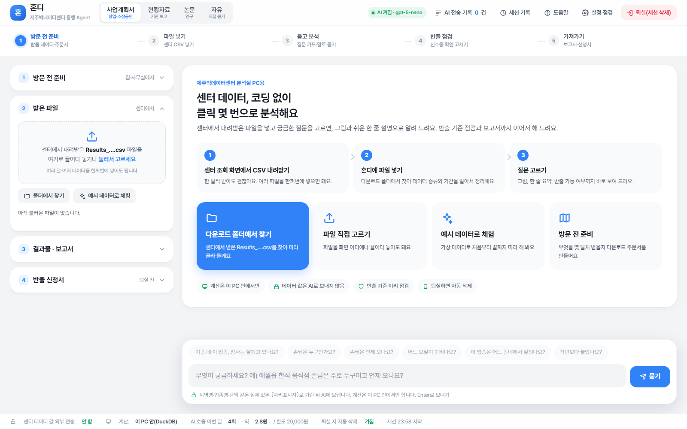

첫 화면에는 센터에서 할 일 3단계(CSV 내려받기 → 혼디에 넣기 → 질문 고르기)와 큰 버튼 4개(**다운로드 폴더에서 찾기 · 파일 직접 고르기 · 예시 데이터로 체험 · 방문 전 준비**)가 있습니다.

> 검은 창을 닫으면 혼디가 꺼지고 이번 세션 자료가 지워집니다. 사용 중에는 닫지 마세요.

## 2. 방문 전 준비(① 방문 전 준비)

1. "무엇을 만드실 건가요?"에 하려는 일을 씁니다. 예) *애월읍에 국수집을 내려고 사업계획서를 씁니다*
2. 관심 지역을 넣고 **받을 데이터 추천**을 누릅니다.
3. 추천 데이터와 기간, 총 내려받기 횟수가 나옵니다. 센터 조회 화면은 **한 번에 1개월씩**만 조회·다운로드되기 때문입니다.
4. **다운로드 주문서 열기(인쇄)** — 센터에서 순서대로 체크하며 내려받을 수 있는 표입니다.
5. 운영자 요청문 — 여러 달이 필요하면 [복사]해서 센터 운영자에게 보내 미리 받아 두도록 요청할 수 있습니다(받은 파일은 바탕화면 `요청파일` 폴더).
6. **제주데이터허브 공개 데이터 미리보기** — 유동인구·버스·날씨 공개 데이터를 미리 봅니다. 허브 키가 없으면 '예시(가상)'로 표시됩니다.

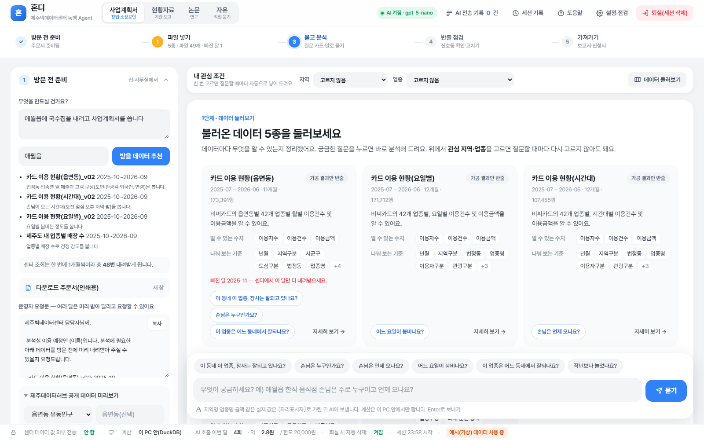

## 3. 파일 넣기(② 받은 파일)

1. 센터 조회 화면에서 Search → Result → CSV 다운로드로 받은 파일(`Results_날짜_시간.csv`)을 **이름을 바꾸지 말고** ② 칸에 끌어다 놓습니다. 칸을 눌러 고르거나 **폴더에서 찾기**(다운로드·바탕화면\요청파일 폴더 자동 탐색)를 씁니다. 화면 아무 곳에 끌어다 놓아도 됩니다.
2. 혼디가 컬럼을 보고 어떤 데이터인지, 몇 월 자료인지 알아내 같은 데이터끼리 합칩니다.
3. 데이터별로 기간 막대가 나옵니다. **빗금 칸은 빠진 달**입니다. 같은 파일을 두 번 넣으면 '중복'으로 건너뜁니다.
4. 처음이면 **예시 데이터로 체험**을 눌러 보세요(가상 데이터 49개 파일, 2025년 11월 카드 파일 하나를 일부러 뺐습니다).
5. 데이터 이름(또는 **ⓘ 자세히**)을 누르면 **월별 행 수 막대**(빠진 달은 빨간 빗금), **컬럼 목록**(한글 이름·종류·값 가짓수·자주 나오는 값), **이 데이터로 바로 할 수 있는 분석** 카드가 나옵니다. 카드를 누르면 바로 분석이 시작됩니다.

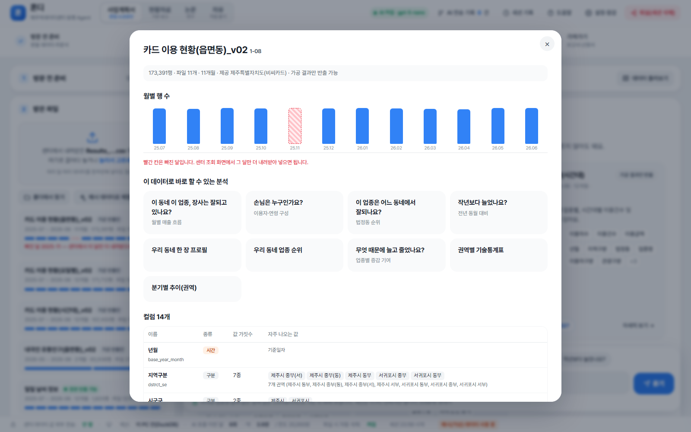

### 3-1. 데이터 둘러보기와 내 관심 조건

파일을 넣으면 가운데가 **데이터 둘러보기** 화면으로 바뀝니다. 데이터마다 "무엇을 알 수 있는지"(명세서 설명), **알 수 있는 수치**(이용금액 등), **나눠 보는 기준**(법정동·업종 등), 기간과 빠진 달, **바로 누를 질문**이 카드로 나옵니다. 결과를 만든 뒤에도 위쪽 **데이터 둘러보기** 버튼으로 다시 볼 수 있습니다.

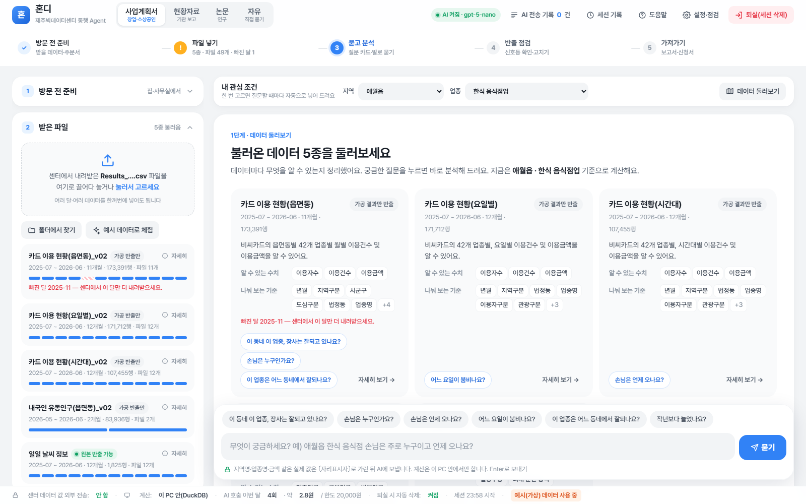

위쪽 **내 관심 조건**에서 지역(예: 애월읍)과 업종(예: 한식 음식점업)을 한 번 고르면, 이후 질문 카드를 누를 때 그 값이 자동으로 들어가 **고르는 단계 없이 바로 계산**합니다. 목록에는 불러온 데이터에 있는 값만 자주 나오는 순으로 나옵니다. 관심 조건은 이 화면에만 기억하고 브라우저·파일에 저장하지 않습니다(퇴실하면 지워집니다).

## 4. 묻고 분석하기

### 4-1. 질문 카드(가장 쉬움)
가운데 카드 중 하나를 누릅니다. 예) *손님은 누구인가요?(이용자·연령 구성)*. 필요한 파일이 없으면 카드가 흐리게 표시되고 무엇이 필요한지 알려 줍니다. 내 관심 조건을 골라 두었으면 바로 계산하고, 아니면 지역·업종을 목록에서 고른 뒤 **이대로 실행**을 누릅니다. 결과 아래에는 같은 조건으로 **이어서 볼 만한 질문**이 나옵니다.

### 4-2. 말로 묻기
질문 칸에 쓰고 **묻기**. 예) *애월읍 한식 음식점업 손님은 주로 누구이고 언제 오나요?*

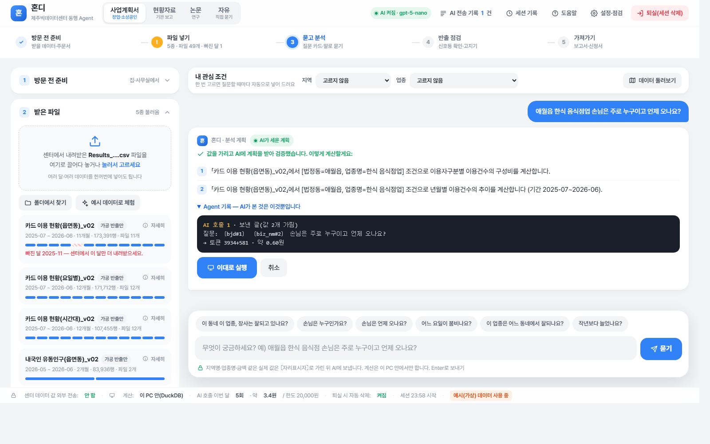

- **분석 계획**: 실행 전에 무엇을 어떻게 계산할지 쉬운 말로 보여 줍니다. 마음에 들지 않으면 취소하고 다시 물으세요.
- **Agent 기록 — AI가 본 것은 이것뿐입니다**: 실제로 AI에 보낸 글입니다. '애월읍'은 `〔bjd#1〕`처럼 가려져 있습니다. 토큰 수와 비용(원)도 보입니다.
- 지역·업종 칸이 비어 있으면 목록에서 골라 줍니다(불러온 데이터에 있는 값만 고를 수 있습니다).
- **이대로 실행**을 누르면 이 PC 안에서 계산합니다.

## 5. 결과 읽기와 반출 신호등

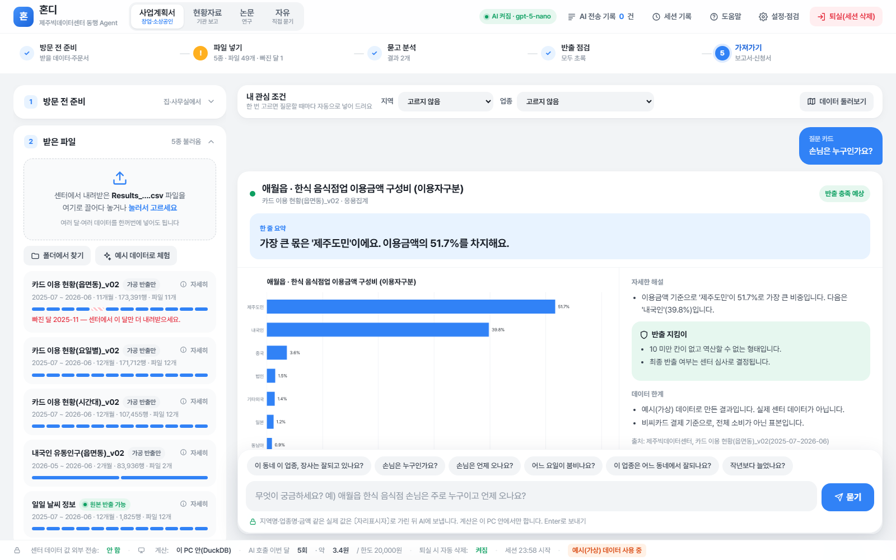

결과 카드 맨 위 파란 칸이 **한 줄 요약**입니다. 예) *가장 큰 몫은 '제주도민'이에요. 이용금액의 51.7%를 차지해요.* · *이용금액 1위는 '노형동'이에요. 2위 '애월읍'보다 1.2배 많아요.* 그림 아래 **그래프 읽는 법**은 그 그림을 어떻게 보면 되는지 알려 줍니다(예: "막대가 길수록 차지하는 몫이 커요. 모두 더하면 100%예요."). 그 아래에 자세한 해설, **반출 지킴이**, 데이터 한계, 출처가 붙습니다. 한 줄 요약은 AI가 아니라 계산 결과에서 정해진 규칙으로 만들어 같은 입력이면 늘 같고, 10 미만이라 가린 칸은 쓰지 않습니다. 사업계획서·현황자료 보고서에도 그림마다 한 줄 요약이 들어갑니다.

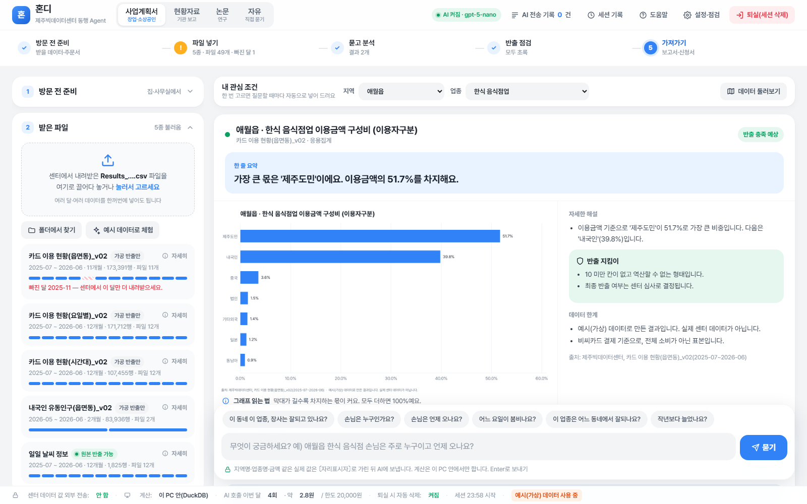

| 신호등 | 뜻 | 할 일 |
|---|---|---|
| 초록 **반출 충족 예상** | 10 미만 칸이 없고 역산할 수 없음 | 그대로 보고서·신청서에 넣기 |
| 노랑 **반출 고치면 가능** | 10 미만 칸, 원본 한 행만 묶인 칸 등 | 고치기 버튼 한 번 |
| 빨강 **반출 어려움** | 고쳐도 기준을 맞추기 어려움 | 조건을 넓히거나(기간·지역) 빼기 |

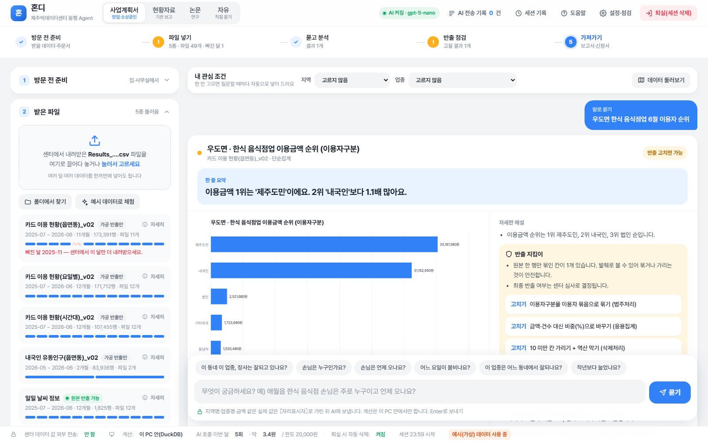

고치기 버튼의 뜻:
- **묶기(범주처리)** — 법정동→읍면동·도심구분, 월→분기→연, 업종→업종 대분류, 연령→연령 구간, 이용자구분→이용자 묶음(내국인·법인 / 외국인).
- **비중(%)으로 바꾸기(응용집계)** — 금액·건수 대신 비율.
- **10 미만 칸 가리기 + 역산 막기(삭제처리)** — 가린 칸이 한 열에 하나뿐이면 합계로 역산되므로 한 칸을 더 가립니다.
- **그림에서 수치 빼기** — 막대 길이만 보이고 숫자 표기를 지웁니다.

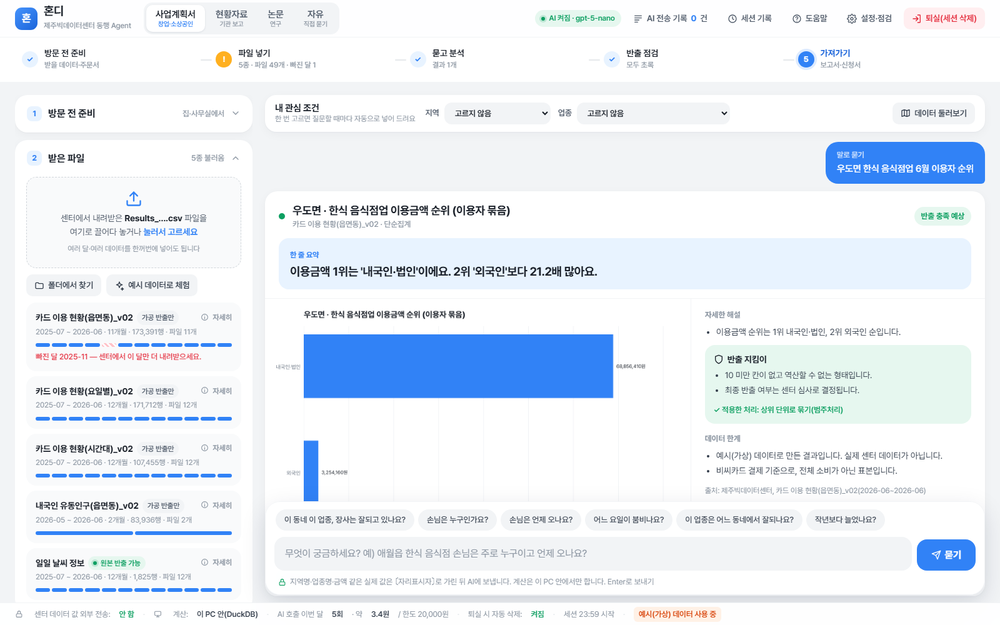

### 조건 바꿔 다시
결과 아래 **조건 바꿔 다시**를 누르면 지역·업종 같은 조건, 기간(시작~끝 월), 지표(이용금액·이용건수 등)를 목록에서 골라 같은 분석을 다시 돌릴 수 있습니다. 원래 결과는 그대로 남고 새 결과가 바로 아래에 붙으며, 새 결과도 반출 지킴이가 다시 점검합니다. 예) 애월읍 → 노형동으로 바꿔 두 동네 비교 자료 만들기.

### 결과 빼기와 되돌리기
**결과 빼기**를 누르면 7초 동안 아래에 **되돌리기** 버튼이 뜹니다. 실수로 뺐다면 눌러서 되살리세요.

> 신호등은 센터 반출 기준(2026.09.01 개정)에 따른 **예상**입니다. 최종 반출 여부는 센터 심사로 결정됩니다.

## 6. 보고서와 반출 신청서

1. 왼쪽 ③에서 넣을 결과를 체크하고(빨강은 자동 제외) **▲▼로 실릴 순서를 정한 뒤**, 제목을 쓰고 **보고서 만들기** → PDF와 HTML이 만들어집니다. 목적별 목차(예: 사업계획서 — 시장 규모와 추이 / 고객 특성 / 이용 시간대·요일 / 경쟁·입지 비교 / 시사점), 그림마다 출처, 마지막에 데이터 출처와 한계가 들어갑니다.
2. 왼쪽 ④에 어디에 쓸지 쓰고 **신청서 초안 만들기** → 센터 반출 신청 화면의 칸(제목·설명·활용데이터·파일구분·첨부) 그대로 나옵니다. [복사]를 눌러 붙여 넣으세요.
   보고서가 만들어지면 **여기서 미리보기**로 혼디 화면 안에서 바로 확인할 수 있습니다.
3. **점검 메모(첨부용)** — 대회 게시판 안내(2026.11.15)에 맞춰 활용 목적, 원본 데이터, 분석 방법, 결과물별 적용 조건·가공 처리·10 미만 처리·역산 점검을 표로 정리한 문서입니다. 심사 담당자가 빨리 확인할 수 있도록 함께 첨부하면 좋습니다.
4. **반출 신청 묶음(ZIP)** — 보고서 PDF·HTML, 그림, 점검 메모, 신청서 초안(텍스트)을 ZIP 하나로 내려받습니다. 반출 신청 화면에 첨부할 파일이 한곳에 모입니다.

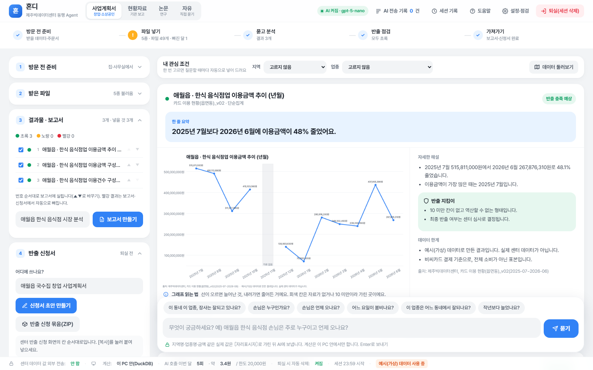

## 7. AI 전송 기록과 설정

- **AI 전송 기록**: 이번 세션에서 외부 AI로 나간 글 전부와 이번 달 사용량·비용을 봅니다.
- **세션 기록**(시계 아이콘): 이번 세션에서 한 일(파일 불러오기·분석·고치기·보고서)을 시간순으로 봅니다. 지역명·금액 같은 데이터 값은 기록하지 않습니다.
- **도움말**(? 아이콘 또는 키보드 `?`): 사용 순서와 단축키. `/` 질문 칸으로, `Alt+1~4` 왼쪽 단계 열기, `Esc` 창 닫기.
- 혼디 서버(실행.bat 창)와 연결이 끊기면 화면 위에 빨간 안내가 뜨고, 다시 연결되면 저절로 사라집니다. 실패한 작업은 알림의 **다시 시도**로 다시 할 수 있습니다.
- **설정·점검**: AI 해설에 집계값 보내기(기본 꺼짐), 퇴실 시 자료 삭제(기본 켜짐), 결과물만 보존, 큰 글씨, 설치 점검 결과.

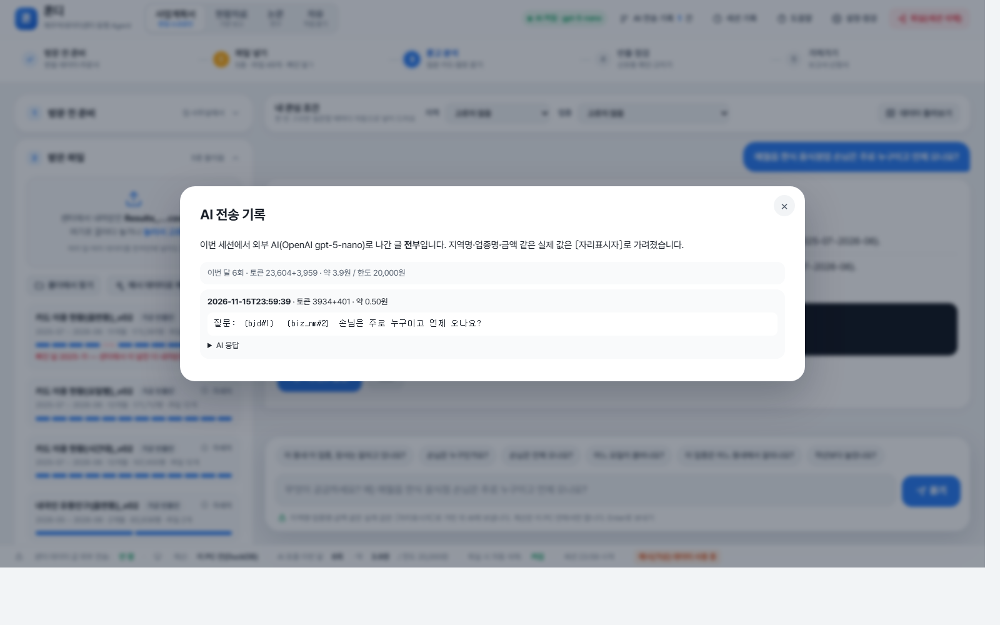

## 8. 퇴실

반출 신청을 마쳤다면 오른쪽 위 **퇴실(세션 삭제)** → **삭제하고 새로 시작**. 혼디에 끌어다 놓은 파일 사본, 결과·보고서, AI 기록이 이 PC에서 지워집니다. `실행.bat` 창을 닫아도 지우며, 혹시 지우지 못한 자료는 다음에 혼디를 켤 때 정리합니다.

> **폴더에서 찾기**로 읽은 원본 CSV(다운로드 폴더 등)는 혼디가 지우지 않습니다. 퇴실 화면에 남은 폴더가 표시되니 직접 지워 주세요.

## 9. 자주 묻는 질문·오류

| 증상 | 원인 | 해결 |
|---|---|---|
| "모르는 파일" | 지원하지 않는 데이터이거나 열 이름이 다른 파일 | 센터 조회 화면에서 받은 원래 파일인지 확인 |
| "중복" | 같은 파일(또는 내용이 같은 파일)을 두 번 넣음 | 한 번만 반영했으니 무시해도 됩니다 |
| "어느 데이터인가요?" | 컬럼 구성이 똑같은 데이터(예: 내국인/중국인 카드 이용 금액) | 센터 화면에서 고른 데이터 버튼을 누르기 |
| 빗금(빠진 달) | 그 달 파일이 없음 | 센터에서 그 달만 더 내려받기 |
| "값을 먼저 골라 주세요" | 지역·업종이 정해지지 않음 | 목록에서 고르기 |
| 전년 대비가 안 나옴 | 13개월 미만 | 13개월 이상 불러오기 |
| AI가 엉뚱한 계획 | 질문이 모호함 | 데이터·지역·업종을 넣어 다시 묻거나 질문 카드 사용 |
| "AI 없이 질문 카드 모드" | 키 없음·월 한도 초과·인터넷 끊김 | 카드로 진행(모든 분석 가능) |
| PDF 버튼이 없음 | Edge가 없음 | HTML로 보기 → 인쇄 → PDF로 저장 |

## 10. 지원 데이터(분석 도구 전체 지원)

카드 이용 현황(읍면동·요일별·시간대)_v02, 내국인 유동인구(읍면동)_v02, 제주도 내 업종별 매장 수, 외식업 포스 이용 현황(읍면동), 버스 정류소별 이용 현황, 일일 날씨 정보. 그 밖의 센터 데이터도 명세서(71종)의 컬럼으로 종류를 인식하고, 기간·수치 컬럼이 있으면 같은 도구(추이·비중·순위 등)를 쓸 수 있습니다. 질문 카드는 위 데이터 기준으로 준비되어 있습니다.
